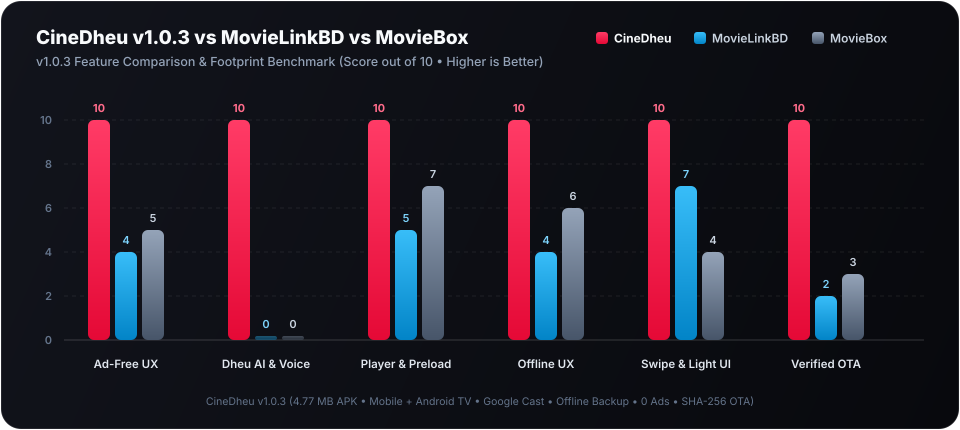

# CineDheu

### Stream Movies, Series & Anime Without Limits

A lightweight, native Android OTT streaming and offline media app crafted with a dark liquid-glass interface, hardware-accelerated playback, and built-in verified updates.

[-10B981?style=for-the-badge&logo=android&logoColor=white)](https://github.com/code9xrs-hub/CineDheu/releases/latest)

 

&nbsp;&nbsp;

---

## App Information

| Detail | Specification |
| :--- | :--- |
| **App Name** | CineDheu |
| **Platform** | Android 8.0+ (Mobile, Android TV, Google TV & Fire TV) |
| **Latest Version** | `v1.0.5` (`versionCode 6`) |
| **Download Format** | Signed Release APK (`app-release.apk`, ~4.59 MB) |
| **Account / Login** | Not required (100% private, zero account tracking) |
| **AI Assistant** | Built-in **Dheu AI** (Gemma 4) with natural general-purpose chat, typing animations & 19-category app guide |
| **Updates** | Built-in OTA updater via GitHub Releases (Stable & Beta channels) |

---

## What's New in v1.0.5
- **Dheu AI Screenshot Search** (Gemma 4 Vision)
- **Pulsing Dheu AI mascot** & redesigned suggestion cards
- **Live circular download progress** & episode status icons
- **Redesigned Settings**, Data Saver Mode & Telegram link
- **Adaptive streaming** & auto network recovery

---

## Key Features

### Dheu AI & Voice Experience
- **Dheu AI App Guide**: Accessible directly from the Home top bar (`CineDheu Logo → Dheu AI → Download`) with an animated mascot (blinking + randomized ear twitches) and `"AI can make mistakes."` transparency notice.
- **19-Category User Knowledge System**: Lightweight structured retrieval answers user questions about every screen, button, setting, and troubleshooting step in natural English or Bengali.
- **Hands-Free Voice Typing**: Native Android speech recognition in both **Dheu AI Chat** (review before sending) and **Search** (automatically submits search when speech completes).

### Cinema-Grade Streaming, Google Cast & Player
- **Landscape Theatre Player**: Built on AndroidX Media3 ExoPlayer with fast startup, adaptive smart preloading (up to 5 minutes), rounded progress track with circular red thumb, and automatic next-episode playback.
- **Google Cast SDK**: Tap the Cast icon (immediately before PiP) to discover Cast devices, auto-connect, and control Play, Pause, Seek, and Disconnect remotely.
- **Picture-in-Picture (PiP)**: Keep watching in a floating window while multitasking across apps.
- **Multi-Audio & Live Subtitle Studio**: Switch audio tracks, toggle external/embedded subtitles, and preview caption size, color, font, and background opacity in real time.
- **Smart Gesture & TV Remote Controls**: Touch gestures for volume/brightness/double-tap seek on Mobile, plus full D-pad & media key remote control on Android TV / Fire TV.

### Offline Downloads, Backup & Connectivity UX
- **Save for Offline Viewing**: Download movies and series episodes directly inside the app with live **Pause**, **Resume**, and **Cancel** notifications.
- **Offline Backup & Restore**: Export & import your personal Watchlist, Continue Watching progress, Search History, and Preferences via Android's Storage Access Framework (`cinedheu_backup_YYYY-MM-DD.json`).
- **Smart Offline Navigation**: Pressing Back on the Offline Downloads screen returns Home when online, or shows a YouTube-style `"You're offline • Connect to the internet to go Home"` prompt when offline.
- **Auto-Hide & Swipeable Banner**: Connectivity status banners automatically dismiss after 3.5 seconds or can be swiped left/right to hide immediately.

### Discovery, Swipe Navigation & Multi-Page Settings
- **Adaptive Navigation**: Swipeable floating pill bottom bar on Mobile; left `TvNavigationRail` with smooth zoom-in focus on Android TV / Google TV / Fire TV.
- **Stable Detail Pages**: Deterministic data-source selection prevents poster and backdrop flickering between metadata providers.
- **Rich Title Details & Watchlist**: Browse trending spotlights, recent search chips, TMDb-enriched cast & ratings, Watchlist bookmarks, and Continue Watching sync.
- **Multi-Page Settings & Support**: Dedicated Settings subpages for Playback, Subtitle Studio, Storage & Backup, App Updates, and Support CineDheu.

### Verified In-App OTA Updates
- **Automatic & Manual Update Checks**: Check for new releases from **Settings → App Updates** or automatically on launch.
- **Stable & Beta Channels**: Stay on Stable releases or opt into Beta previews anytime.
- **SHA-256 & Signing Verification**: Every downloaded update APK is verified against its release SHA-256 checksum and app signing certificate before installation.

---

## Comparison & Benchmark

  

| Feature | CineDheu v1.0.5 | MovieLinkBD | MovieBox |
| :--- | :--- | :--- | :--- |
| **Mobile + Android TV & Fire TV Remote** | Yes (Adaptive Rail + D-Pad Zoom) | No | Partial |
| **Watch by OTT, Views & Verdict** | Yes (OTT Rail + Views + Community Verdict) | Partial | No |
| **Offline Backup & Restore (JSON)** | Yes (Export + Safe Merge Import) | No | Account Cloud Only |
| **Dheu AI Assistant (Gemma 4) & Voice** | Yes (General AI + 19-Category Guide, EN & BN) | No | No |
| **Smart Preload, Gestures & PiP** | Up to 5 min buffer + 2x Long-Press + PiP | Basic | Standard |
| **Ad-Free & Zero Accounts** | 100% Ad-Free | Ad-Supported | Ads / Prompts |
| **Signed APK Size** | `~4.59 MB` (`4,811,420` bytes) | — | Larger Bundle |
| **Verified OTA Updates** | SHA-256 + Signing Cert Check | Manual | Manual |

---

## How to Install

1. Tap **[Download CineDheu APK](https://github.com/code9xrs-hub/CineDheu/releases/latest/download/app-release.apk)** above to get the latest `app-release.apk`.
2. Open the downloaded `.apk` file from your browser or file manager.
3. If prompted by Android, allow **Install unknown apps** for your browser or file manager (and for CineDheu when installing future in-app updates).
4. Tap **Install** and launch **CineDheu**.

> **Integrity Check:** Every official release includes `app-release.apk.sha256` and `release.json` on the [Releases page](https://github.com/code9xrs-hub/CineDheu/releases) so you can verify your download before installing.
